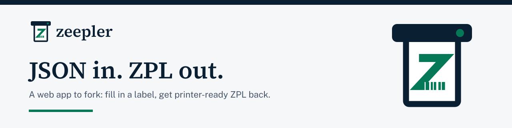

<a href="https://zeepler.com/?utm_source=github&utm_medium=readme&utm_campaign=zeepler-web-starter">
  <picture>
    <source media="(prefers-color-scheme: dark)" srcset=".github/assets/readme-banner-dark.svg">
    
  </picture>
</a>

# zeepler web starter

A small web app to fork as the start of your own zeepler integration: fill in a label, get ZPL back.

[](https://github.com/Bates-Solutions/zeepler-web-starter/actions/workflows/ci.yml)
[](https://github.com/Bates-Solutions/zeepler-web-starter/releases)
[](LICENSE)

<a href="https://zeepler.com/auth/signup?utm_source=github&utm_medium=readme&utm_campaign=zeepler-web-starter">
  <picture>
    <source media="(prefers-color-scheme: dark)" srcset=".github/assets/readme-cta-dark.svg">
    
  </picture>
</a>

**Live demo:** https://bates-solutions.github.io/zeepler-web-starter/

[zeepler](https://zeepler.com/?utm_source=github&utm_medium=readme&utm_campaign=zeepler-web-starter)
turns structured data into printer-ready ZPL for Zebra printers, with no ZPL to learn. This starter
is reference code for it, meant to be read and changed.

## Features

- Connects to your zeepler account with an API key.
- Lets you fill in a label, sends it to `POST /v1/zeeplify`, and shows the ZPL that comes back,
  ready to copy.
- One file defines the label and one file holds the API calls, so there is one place to change
  each.
- Shows a validation error (`400`) on the input it belongs to, and every other error as a message
  saying what to do.

## Quick start

You need Node.js 26 or later.

```bash
git clone https://github.com/Bates-Solutions/zeepler-web-starter.git
cd zeepler-web-starter
npm ci
npm run dev
```

Open the address it prints, paste your API key under **Account**, and press **Test connection**.

## Usage

### Changing the label

Everything about the label is in [`src/label/definition.ts`](src/label/definition.ts). The form
is generated from its `FIELDS`. To change the label, edit that file and nothing else.

Each field becomes one entry in `data`, keyed by its `id`, and one element in `templates` that
prints it:

```ts
{
  id: 'bin',
  label: 'Bin location',
  input: 'text',
  required: true,
  maxLength: 12,
  example: 'A-04-03',
  element: { type: 'Text', coords: [30, 235], font: '0,60', maxLength: 12 },
}
```

becomes

```json
{
  "config": { "size": "4x2" },
  "data": { "bin": "A-04-03" },
  "templates": [{ "type": "Text", "coords": [30, 235], "font": "0,60", "maxLength": 12, "dataPath": "bin" }]
}
```

Coordinates are in dots at 203 dpi, measured from the top-left corner. A 4 × 2 in label is
812 × 406 dots. The element types are `Text`, `BarCode` and `QRCode`, and the
[API documentation](https://zeepler.com/documentation?utm_source=github&utm_medium=readme&utm_campaign=zeepler-web-starter)
lists every option.

⚠️ **Print a label on real stock after changing any coordinate, font or length.** ZPL text does
not wrap, and neither the app nor the API can tell that two elements overlap or that text runs
off the edge.

### Errors from the API

When the API refuses a request (`400`), each error names a path such as `templates[2].dataPath`.
`buildRequest` returns which field each template came from, so the error appears on the right
input.

All API calls are in [`src/api/zeepler.ts`](src/api/zeepler.ts): `me()` and `zeeplify()`, with
a typed error for each answer the API gives:

| Answer    | `kind`                          | Shown as                                                              |
| --------- | ------------------------------- | --------------------------------------------------------------------- |
| `400`     | `invalid`                       | Each error on its input                                               |
| `401`     | `unauthorized`                  | The reason, with a pointer to Account                                 |
| `402`     | `capped`                        | The free monthly labels are used, with a link to the dashboard        |
| `429`     | `rate-limited`/`spending-limit` | How long to wait, from `retryAfter` in the body; or the limit reached |
| `5xx`     | `server`                        | Try again shortly                                                     |
| No answer | `network`                       | Check the connection and the base URL                                 |

The browser cannot read the `Retry-After` header, because the API's CORS policy does not expose
it, so the wait comes from the body.

### Deploying your own copy

`npm run build` writes a static site to `dist/` that any static host can serve. This repo deploys
it to GitHub Pages on every merge to `main` (`.github/workflows/pages.yml`). In a fork, enable
Pages with **Source: GitHub Actions**.

## Configuration

### API key and region

Sign up at
[zeepler.com](https://zeepler.com/auth/signup?utm_source=github&utm_medium=readme&utm_campaign=zeepler-web-starter)
and create a key in the dashboard. It starts `zpl_`. Choose the region your account was created
in: the United States (`api.zeepler.com`) or Canada (`api.ca.zeepler.com`).

**Test connection** calls `GET /v1/me`, which checks the key and reports your plan and this
month's labels without generating one, so it costs nothing. Each **Generate** is one label on
your account. Without a card on file, an account can generate 40 labels a month. See
[pricing](https://zeepler.com/pricing?utm_source=github&utm_medium=readme&utm_campaign=zeepler-web-starter).

### Content-Security-Policy

The Content-Security-Policy is defined in [`vite.config.ts`](vite.config.ts) and added to the
built page. It allows the page to call only the two zeepler regions. **To call a dedicated
deployment's custom base URL, add its host to `connect-src` there**, or the browser will block
the request.

## Limitations

- **It doesn't print.** Send the ZPL to a Zebra printer as raw text: over TCP port 9100 to a
  networked printer, or through a print server or the operating system's print queue as a raw
  job. A browser cannot open a TCP socket, so this needs a small local or server-side component.
  It is deliberately not built here.
- **One label.** For more, make a definition file per label and choose between them in the UI.
  `FIELDS`, `buildRequest` and `fieldForPath` are all the form needs.
- **The key lives in the browser.** See [Security](#security) for moving it server-side.

## Development

| Command             | What it does                                            |
| ------------------- | ------------------------------------------------------- |
| `npm run dev`       | Development server with hot reload                      |
| `npm run build`     | Static build in `dist/`                                 |
| `npm test`          | Unit and component tests, including an axe check        |
| `npm run lint`      | ESLint                                                  |
| `npm run typecheck` | TypeScript                                              |
| `npm run check:csp` | After a build, checks `dist/index.html` carries the CSP |

Releases are cut by semantic-release from [Conventional Commits](https://www.conventionalcommits.org/)
when a change reaches `main`.

## Security

Read this before you deploy a copy for other people.

- **Browser storage cannot hide a key from JavaScript running on the same page.** With
  "Remember on this device" on, the key is in `localStorage`; off, it is in `sessionStorage` and
  goes when the tab closes. Either way, any script on the page can read it.
- **Each user brings their own key.** Never bake a key into a build or an environment variable:
  everything in a static build is public.
- **Don't host it on an origin that serves other code.** Another app on the same origin can read
  this one's storage.
- **For a shared deployment, put the key behind your own backend.** Replace `src/api/zeepler.ts`
  with calls to your server, and have the server add the key.
- The app loads nothing from a third party at runtime: no analytics, fonts or CDNs. It never
  writes HTML from strings, which ESLint enforces, and it never logs label content.

Please report a vulnerability privately, as described in [SECURITY.md](SECURITY.md). Don't open a
public issue for it.

## Contributing

Contributions are welcome. See [CONTRIBUTING.md](CONTRIBUTING.md) and the
[code of conduct](https://github.com/Bates-Solutions/.github/blob/main/CODE_OF_CONDUCT.md).

## License

[MIT](LICENSE). The license covers the code. The zeepler and Bates Solutions names and logos are
not licensed for reuse. To take them out of your copy:

1. In `src/App.tsx`, remove the header logo and `zeepler.com` button, the footer credit, and the
   imports from `./brand/`. Point the remaining zeepler link at your own documentation if you like.
2. Delete `src/brand/` (its test goes with it).
3. Delete `public/favicon.svg` and its `<link rel="icon">` in `index.html`, or replace the file
   with your own icon.
4. In this README, remove the banner, the call to action and the footer, and delete
   `.github/assets/`.

---

[zeepler.com](https://zeepler.com/?utm_source=github&utm_medium=readme&utm_campaign=zeepler-web-starter) ·
[Documentation](https://zeepler.com/documentation?utm_source=github&utm_medium=readme&utm_campaign=zeepler-web-starter) ·
[Pricing](https://zeepler.com/pricing?utm_source=github&utm_medium=readme&utm_campaign=zeepler-web-starter)

zeepler is a [Bates Solutions](https://bates-solutions.com/?utm_source=github&utm_medium=readme&utm_campaign=zeepler-web-starter) product.
